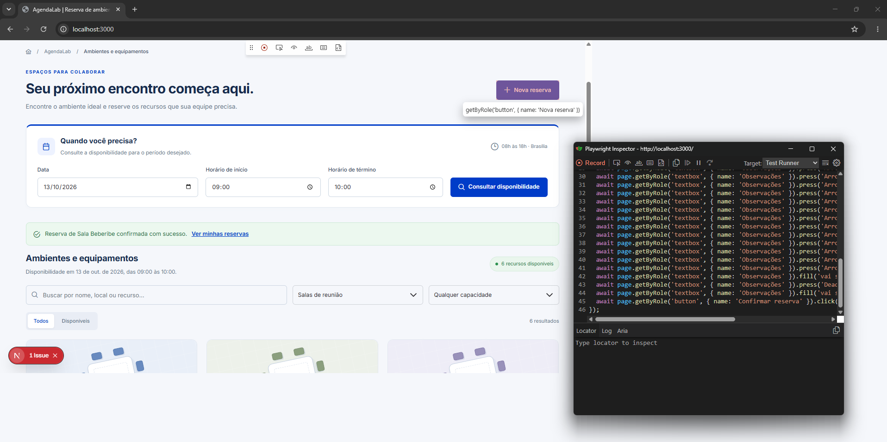

# AgendaLab: laboratório de testes automatizados com Playwright

Este repositório é um laboratório prático para aprender **testes automatizados com Playwright**. A aplicação usada nos estudos é o **AgendaLab**, um sistema de reserva de ambientes e equipamentos compartilhados: salas de reunião, projetores e notebooks.

A proposta é construir o aprendizado por etapas: conhecer os fluxos da aplicação, escrever os primeiros testes e evoluir a organização da suíte. Os cenários se aproximam de sistemas administrativos do setor público, para facilitar a aplicação dos conceitos no trabalho.

A aplicação utiliza **Next.js no frontend, NestJS na API e SQLite para persistência**, com a identidade visual do UI Kit do Governo de Pernambuco. Todos os dados são fictícios e o projeto não tem vínculo institucional.

**Estado atual:** a aplicação, o Swagger e a integração inicial com Playwright estão implementados. O projeto já conta com arquivos de testes E2E, configuração dos navegadores e workflow no GitHub Actions.

---

## Sumário

1. [Objetivo do laboratório](#1-objetivo-do-laboratório)
2. [Fundamentos do Playwright](#2-fundamentos-do-playwright)
3. [Como rodar a aplicação e a suíte](#3-como-rodar-a-aplicação-e-a-suíte)
4. [Experimente a aplicação](#4-experimente-a-aplicação)
5. [Tutorial: gravar e executar um teste de reserva](#5-tutorial-gravar-e-executar-um-teste-de-reserva)
6. [Detalhes do Playwright](#6-detalhes-do-playwright)
   - [6.1. Como instalar](#61-como-instalar)
   - [6.2. Navegação e localizadores](#62-navegação-e-localizadores)
   - [6.3. Ações básicas](#63-ações-básicas)
   - [6.4. Asserções](#64-asserções)
   - [6.5. Exemplo de teste explicado](#65-exemplo-de-teste-explicado)
   - [6.6. Gravar interações com o Codegen](#66-gravar-interações-com-o-codegen)
   - [6.7. Executar testes na UI](#67-executar-testes-na-ui)
   - [6.8. Preparar dados para repetir os testes](#68-preparar-dados-para-repetir-os-testes)
7. [Testes E2E existentes](#7-testes-e2e-existentes)
8. [Configuração do Playwright](#8-configuração-do-playwright)
9. [Tutorial prático: gravar e executar um teste real](#9-tutorial-prático-gravar-e-executar-um-teste-real)
   - [9.1. Preparar o projeto](#91-preparar-o-projeto)
   - [9.2. Iniciar a aplicação e explorar os testes](#92-iniciar-a-aplicação-e-explorar-os-testes)
   - [9.3. Gravar a reserva da Sala Frevo](#93-gravar-a-reserva-da-sala-frevo)
   - [9.4. Salvar e executar o teste](#94-salvar-e-executar-o-teste)
   - [9.5. Ajustar os dados para repetir](#95-ajustar-os-dados-para-repetir)
10. [Referências](#10-referências)

---

## 1. Objetivo do laboratório

Aprender a verificar o comportamento de uma aplicação real usando seus fluxos de negócio. O ponto de partida são quatro funcionalidades:

| Funcionalidade                  | Comportamento esperado                                          |
| ------------------------------- | --------------------------------------------------------------- |
| Visualizar salas e equipamentos | Consultar os recursos disponíveis para uma data e um período    |
| Criar uma reserva               | Preencher o formulário e confirmar a reserva de um recurso      |
| Consultar minhas reservas       | Encontrar a reserva criada e acompanhar sua situação            |
| Cancelar uma reserva            | Confirmar o cancelamento e liberar o período para outra reserva |

O estudo vai incluir tanto os fluxos bem-sucedidos quanto situações como campos inválidos, conflitos de horário e listas sem resultados.

---

## 2. Fundamentos do Playwright

O **Playwright Test** é um framework de testes de ponta a ponta para aplicações web. Ele permite automatizar ações no navegador e verificar seus resultados, com suporte a Chromium, Firefox e WebKit. Veja a [introdução oficial](https://playwright.dev/docs/intro).

No AgendaLab, o arquivo `e2e/novaReserva.spec.ts` já preenche e envia uma reserva pelo formulário. Um próximo passo é acrescentar a asserção que confira o resultado em **Minhas reservas**.

Os conceitos principais para desenvolver essa suíte são:

- **Localizadores:** encontrar botões, campos e mensagens pela função e pelo nome apresentados ao usuário.
- **Asserções:** verificar se a aplicação chegou ao resultado esperado.
- **Isolamento:** preparar dados para que um teste não dependa da execução de outro.
- **Diagnóstico de falhas:** investigar os passos da execução e os relatórios.

A referência para essas escolhas será o guia de [boas práticas do Playwright](https://playwright.dev/docs/best-practices). A ferramenta já está instalada como dependência de desenvolvimento. Os testes E2E presentes no projeto estão descritos na [seção 7](#7-testes-e2e-existentes).

---

## 3. Como rodar a aplicação e a suíte

**Pré-requisitos da aplicação:** Node.js 22.13 ou superior e npm 10 ou superior.

Na raiz do repositório:

```powershell
npm install
npm run dev
```

Depois, abra [http://localhost:3000](http://localhost:3000).

O comando inicia os dois aplicativos:

| Aplicativo       | Porta | Endereço                                                             |
| ---------------- | ----- | -------------------------------------------------------------------- |
| Frontend Next.js | 3000  | [http://localhost:3000](http://localhost:3000)                       |
| API NestJS       | 3001  | [http://localhost:3001/api/health](http://localhost:3001/api/health) |
| Swagger da API   | 3001  | [http://localhost:3001/api/docs](http://localhost:3001/api/docs)     |

O banco é criado automaticamente na primeira inicialização, com **seis salas, um projetor e dois notebooks**. Não é necessário instalar um servidor de banco de dados ou configurar um login. Use `Ctrl+C` para encerrar os processos.

Também é possível iniciar os aplicativos separadamente, em dois terminais, a partir da raiz:

```powershell
# Terminal 1: API
npm run dev -w @agendalab/api
```

```powershell
# Terminal 2: frontend
npm run dev -w @agendalab/web
```

---

## 4. Experimente a aplicação

Antes de automatizar, percorra o fluxo manualmente:

1. Abra o catálogo. A consulta inicial considera **amanhã, das 09h às 10h**, e exibe salas de reunião.
2. Altere a data ou os horários e clique em **Consultar disponibilidade**. A alteração dos campos só é aplicada à consulta depois desse clique.
3. Busque uma sala pelo nome, filtre pela capacidade ou selecione projetores e notebooks no filtro de tipo.
4. Clique em **Reservar** em um recurso disponível. Preencha o título, os participantes quando for uma sala e, se desejar, as observações. Confirme a reserva.
5. Abra **Minhas reservas**. Localize a reserva pelo título ou pelo nome do recurso. A página separa reservas próximas/em andamento, concluídas e canceladas.
6. Clique em **Cancelar reserva** e confirme. A reserva passa para a categoria **Canceladas**.
7. Volte ao catálogo e consulte o mesmo período. O recurso deve estar disponível novamente, desde que não exista outra reserva confirmada nesse intervalo.

O colaborador utilizado é **Ana Silva**, uma identidade fixa de demonstração. As reservas permanecem salvas quando a aplicação é reiniciada.

---

## 5. Tutorial: gravar e executar um teste de reserva

Este roteiro acompanha um fluxo real do AgendaLab: clonar o repositório, explorar os testes existentes e gravar um novo teste de reserva usando o Codegen.

### 5.1. Preparar o projeto

Clone o repositório e entre na pasta criada. Substitua `<URL_DO_REPOSITORIO>` pelo endereço do repositório:

```powershell
git clone <URL_DO_REPOSITORIO> AgendaLab
cd AgendaLab
npm ci
npx playwright install
```

O projeto requer Node.js 22.13 ou superior e npm 10 ou superior. `npm ci` instala as dependências registradas no lockfile, e `npx playwright install` baixa os navegadores usados localmente.

### 5.2. Iniciar a aplicação e explorar os testes

Em um terminal, inicie a aplicação e mantenha esse terminal aberto:

```powershell
npm run dev
```

Em outro terminal, na raiz do repositório, abra a interface de testes:

```powershell
npx playwright test --ui
```

Selecione e execute os testes disponíveis para conhecer a interface, acompanhar as ações e consultar os resultados. Os testes do AgendaLab acessam `http://localhost:3000`, por isso a aplicação precisa estar rodando antes da execução.

### 5.3. Gravar uma reserva na Sala Frevo

Com a aplicação ainda rodando, execute em outro terminal:

```powershell
npx playwright codegen http://localhost:3000
```

Na página inicial, clique no card ou link **Ambientes e equipamentos**. Na lista de salas, localize a **Sala Frevo** e clique em **Reservar**. No formulário de nova reserva, preencha os campos apresentados um a um e clique em **Confirmar reserva**. Depois de concluir o fluxo, encerre a gravação e revise o código gerado no Playwright Inspector.

### 5.4. Salvar e executar o teste gravado

Copie o código gerado para um novo arquivo dentro de `e2e/`, com um nome terminado em `.spec.ts`, por exemplo `e2e/novaReservaFrevo.spec.ts`. Abra o arquivo no VS Code e revise as ações gravadas antes de executar.

Volte à interface de testes e execute o novo arquivo. Também é possível executá-lo diretamente no terminal:

```powershell
npx playwright test e2e/novaReservaFrevo.spec.ts --project=chromium
```

A gravação cria ações de navegação e preenchimento. Confira o código e acrescente as asserções necessárias para verificar se a reserva foi confirmada e aparece no resultado esperado.

### 5.5. Ajustar os dados antes de repetir

Antes de executar o cenário novamente, altere os dados da reserva, principalmente a data, e escolha um período futuro disponível. O banco SQLite mantém as reservas entre execuções; portanto, repetir os mesmos dados pode encontrar um horário ocupado. Este tutorial ainda não prepara dados diferentes automaticamente nem limpa as reservas criadas.

---

## 6. Detalhes do Playwright

Esta seção reúne os exemplos e as ferramentas usados para criar, executar e revisar testes E2E no AgendaLab.

### 6.1. Como instalar

No AgendaLab, a dependência já está instalada. Para começar com Playwright em outro projeto, use:

```powershell
npm init playwright@latest
```

### 6.2. Navegação e localizadores

Um teste de interface normalmente combina **navegação, localização de elementos, ações e asserções**.

Primeiro, navegamos até a página que queremos testar:

```typescript
await page.goto("https://playwright.dev/");
```

Depois, localizamos os elementos com a API de **Locators**. Um localizador descreve como encontrar um elemento na página; neste exemplo, buscamos um link pelo seu papel e pelo nome acessível **Get started**:

```typescript
const getStarted = page.getByRole("link", { name: "Get started" });
```

Com o localizador, podemos executar uma ação, como clicar no link:

```typescript
await getStarted.click();
```

Também podemos localizar e interagir em uma única linha:

```typescript
await page.getByRole("link", { name: "Get started" }).click();
```

Após a interação, verificamos o resultado com uma asserção. Clicar em um link, por si só, não confirma que chegamos à página esperada.

Para conhecer os tipos de localizadores disponíveis, consulte a [documentação de Locators](https://playwright.dev/docs/locators).

### 6.3. Ações básicas

As ações permitem interagir com os elementos localizados. Algumas das mais utilizadas são:

| Ação                      | Descrição                                                   |
| ------------------------- | ----------------------------------------------------------- |
| `locator.check()`         | Marcar uma caixa de seleção ou selecionar um botão de opção |
| `locator.click()`         | Clicar no elemento                                          |
| `locator.uncheck()`       | Desmarcar uma caixa de seleção                              |
| `locator.hover()`         | Posicionar o cursor sobre o elemento                        |
| `locator.fill()`          | Preencher um campo de formulário                            |
| `locator.focus()`         | Colocar o foco no elemento                                  |
| `locator.press()`         | Pressionar uma tecla                                        |
| `locator.setInputFiles()` | Selecionar arquivos em um campo de upload                   |
| `locator.selectOption()`  | Selecionar uma opção em um elemento HTML `<select>`         |

A tabela apresenta os nomes dos métodos. Alguns precisam de argumentos, como o texto a preencher ou a tecla a pressionar:

```typescript
await page.getByLabel("Nome").fill("Ana Silva");
await page.getByLabel("Nome").press("Tab");
```

Para a lista completa, consulte a [API de Locator](https://playwright.dev/docs/api/class-locator).

### 6.4. Asserções

As **asserções** verificam se o resultado corresponde ao comportamento esperado. No Playwright Test, usamos `expect(valor)` seguido de um método que expressa essa expectativa.

As asserções de página e de elementos mostradas abaixo são assíncronas: elas repetem a verificação até que a condição seja atendida ou o tempo limite seja atingido. Isso ajuda a lidar com atualizações da interface que não acontecem imediatamente.

Por exemplo, esta asserção aguarda até que o título da página contenha **Playwright**:

```typescript
await expect(page).toHaveTitle(/Playwright/);
```

Algumas das asserções mais utilizadas são:

| Asserção                                                      | O que verifica                                            |
| ------------------------------------------------------------- | --------------------------------------------------------- |
| `expect(locator).toBeChecked()`                               | A caixa de seleção ou o botão de opção está marcado       |
| `expect(locator).toBeEnabled()`                               | O controle está habilitado                                |
| `expect(locator).toBeVisible()`                               | O elemento está visível                                   |
| `expect(locator).toContainText('Texto')`                      | O elemento contém o texto informado                       |
| `expect(locator).toHaveAttribute('type', 'text')`             | O elemento possui o atributo com o valor informado        |
| `expect(locator).toHaveCount(3)`                              | O localizador encontra a quantidade esperada de elementos |
| `expect(locator).toHaveText('Texto esperado')`                | O conteúdo textual corresponde ao esperado                |
| `expect(locator).toHaveValue('Ana Silva')`                    | O campo possui o valor informado                          |
| `expect(page).toHaveTitle(/Playwright/)`                      | O título da página corresponde à expectativa              |
| `expect(page).toHaveURL('https://playwright.dev/docs/intro')` | A página está na URL esperada                             |

Os valores nos exemplos da tabela devem ser ajustados ao cenário do teste. Nas chamadas assíncronas, use `await`:

```typescript
await expect(page.getByLabel("Nome")).toHaveValue("Ana Silva");
```

Também existem asserções genéricas, como `toEqual`, `toContain` e `toBeTruthy`. Elas verificam valores já disponíveis de forma síncrona e não precisam de `await`:

```typescript
const success = true;
expect(success).toBeTruthy();
```

Diferentemente das asserções de elementos, essa verificação não aguarda uma mudança de estado: ela verifica o valor que `success` possui naquele momento.

Consulte a [documentação de asserções](https://playwright.dev/docs/test-assertions) para conhecer outras opções.

### 6.5. Exemplo de teste explicado

Os exemplos abaixo usam o site da documentação do Playwright para demonstrar a estrutura de dois testes independentes:

```typescript
import { test, expect } from "@playwright/test";

test("a página tem o título esperado", async ({ page }) => {
  await page.goto("https://playwright.dev/");

  // Verifica se o título da página contém Playwright.
  await expect(page).toHaveTitle(/Playwright/);
});

test("o link Get started leva à instalação", async ({ page }) => {
  await page.goto("https://playwright.dev/");

  // Localiza o link pelo papel e pelo nome acessível e clica nele.
  await page.getByRole("link", { name: "Get started" }).click();

  // Verifica se o título Installation está visível na página de destino.
  await expect(
    page.getByRole("heading", { name: "Installation" }),
  ).toBeVisible();
});
```

**O que as duas funções têm em comum:**

- `test` declara um caso de teste; o primeiro argumento é o nome exibido nos resultados.
- `expect` é usado para verificar o resultado esperado.
- `async ({ page })` recebe a página fornecida pelo Playwright. Essa página permite navegar e interagir com o navegador durante o teste.
- `await` aguarda a conclusão de cada navegação, ação ou asserção assíncrona antes de continuar.

**Primeiro teste: verificar o título da página.**

1. `page.goto()` abre a página inicial da documentação.
2. `expect(page).toHaveTitle(/Playwright/)` verifica o título da aba do navegador. A expressão regular `/Playwright/` aceita um título que contenha esse termo; não exige que ele seja o texto inteiro.

**Segundo teste: verificar a navegação pelo link.**

1. O teste abre a página inicial novamente, sem depender da execução do primeiro teste.
2. `getByRole('link', { name: 'Get started' })` localiza o link pelo papel e pelo nome acessível.
3. `.click()` executa o clique.
4. `getByRole('heading', { name: 'Installation' })` localiza o título na página de destino.
5. `toBeVisible()` verifica se esse título está visível. Assim, o teste confirma o resultado da navegação.

`toHaveTitle()` verifica o título da aba do navegador; `getByRole('heading')` encontra um título no conteúdo da página. São verificações diferentes.

### 6.6. Gravar interações com o Codegen

O **Codegen** registra interações realizadas no navegador e gera código Playwright com os localizadores correspondentes. Para gravar um fluxo no AgendaLab, inicie a aplicação com `npm run dev` e execute este comando em outro terminal na raiz do repositório:

```powershell
npx playwright codegen http://localhost:3000
```

O navegador e o **Playwright Inspector** serão abertos. Percorra o fluxo que deseja automatizar e copie o código gerado para um arquivo em `e2e/`. Revise o resultado: gravações também podem incluir cliques e preenchimentos que não fazem parte do cenário esperado.



### 6.7. Executar testes na UI

Para abrir a interface de execução, inicie a aplicação em um terminal e execute, na raiz do projeto:

```powershell
npx playwright test --ui
```

A UI permite selecionar e executar cenários, acompanhar as ações e consultar os detalhes de uma falha. Também é possível executar os testes diretamente no terminal:

```powershell
npx playwright test
```

A configuração atual executa os testes nos projetos Chromium, Firefox e WebKit. Para selecionar somente o Chromium:

```powershell
npx playwright test --project=chromium
```

Se os navegadores Playwright ainda não estiverem instalados nessa máquina:

```powershell
npx playwright install
```

### 6.8. Preparar dados para repetir os testes

O fluxo de reserva grava dados de verdade no SQLite. Como o banco persiste entre execuções, repetir a reserva no mesmo recurso e período pode causar um conflito. O teste também usa uma data fixa; atualize-a quando passar ou se o horário já estiver ocupado.

Uma estratégia de preparação e limpeza dos dados, com um banco separado para a suíte, permitirá repetir o cenário com mais facilidade.

---

## 7. Testes E2E existentes

Os testes ficam no diretório `e2e/`:

| Arquivo                            | Cenário                                                                                   | Observação                                                                                                        |
| ---------------------------------- | ----------------------------------------------------------------------------------------- | ----------------------------------------------------------------------------------------------------------------- |
| `e2e/example.spec.ts`              | Abre a documentação do Playwright, verifica o título e acompanha o link **Get started**.  | Depende de acesso à internet; não depende do AgendaLab.                                                           |
| `e2e/novaReserva.spec.ts`          | Seleciona a Sala Araripe, preenche o formulário e envia uma reserva.                      | Usa data e horário fixos; ainda não contém uma asserção que confirme o resultado da reserva.                      |
| `e2e/minhasReservas.spec.ts`       | Abre **Minhas reservas**, percorre as categorias e cancela reservas.                     | Depende de reservas existentes, incluindo registros em 14 e 17 de outubro de 2026; os dados são persistidos.     |
| `e2e/disponibilidade.spec.ts`     | Altera a data e o horário e consulta a disponibilidade.                                  | Usa 15 de outubro de 2026, das 11h às 13h; ainda não verifica o resultado com uma asserção.                       |

O teste `novaReserva.spec.ts` reserva a **Sala Araripe** em **17 de outubro de 2026, das 13h às 15h**. Essa data está fixa no arquivo. A reserva permanece no banco após a execução. Os testes `minhasReservas.spec.ts` e `disponibilidade.spec.ts` também usam datas fixas. Como os cenários de reserva e cancelamento dependem dos dados persistidos, prepare os registros necessários e ajuste as datas e os horários antes de repetir os fluxos.

Os testes gravados de reserva, disponibilidade e cancelamento ainda executam principalmente ações de interface. Eles precisam de asserções para confirmar os resultados esperados.

---

## 8. Configuração do Playwright

A configuração fica em `playwright.config.ts` e procura os testes no diretório `e2e/`. Ela define projetos para Chromium, Firefox e WebKit, usa o relatório HTML e registra o trace na primeira repetição de uma falha.

O servidor local precisa ser iniciado antes de executar a suíte: a opção `webServer` está comentada e a `baseURL` também. Por isso, os testes navegam para `http://localhost:3000` e usam URLs explícitas. A execução local não tem repetição automática; no CI, há até duas tentativas e um worker.

## 9. Tutorial prático: gravar e executar um teste real

Neste exercício, você vai explorar a interface de testes, gravar um fluxo de reserva na Sala Frevo com o Codegen e salvar o código gerado como um teste E2E do AgendaLab.

### 9.1. Preparar o projeto

Clone o repositório, entre na pasta criada e instale as dependências e os navegadores do Playwright. Substitua `<URL_DO_REPOSITORIO>` pelo endereço do repositório:

```powershell
git clone <URL_DO_REPOSITORIO> AgendaLab
cd AgendaLab
npm ci
npx playwright install
```

O projeto requer Node.js 22.13 ou superior e npm 10 ou superior. `npm ci` instala as dependências registradas no lockfile, e `npx playwright install` baixa os navegadores usados localmente.

### 9.2. Iniciar a aplicação e explorar os testes

Em um terminal, inicie a aplicação e mantenha esse terminal aberto:

```powershell
npm run dev
```

Em outro terminal, na raiz do repositório, abra a interface de testes:

```powershell
npx playwright test --ui
```

Selecione e execute os testes disponíveis para conhecer a interface, acompanhar as ações e consultar os resultados. Os testes do AgendaLab acessam `http://localhost:3000`, por isso a aplicação precisa estar rodando antes da execução.

### 9.3. Gravar a reserva da Sala Frevo

Com a aplicação ainda rodando, abra outro terminal na raiz do repositório e inicie o Codegen:

```powershell
npx playwright codegen http://localhost:3000
```

No navegador aberto pelo Codegen, siga este fluxo:

1. Na página inicial, clique no card **Ambientes e equipamentos**.
2. Na lista de salas, localize a **Sala Frevo** e clique em **Reservar**.
3. No formulário de nova reserva, preencha cada campo apresentado.
4. Clique em **Confirmar reserva**.
5. Encerre a gravação e revise o código gerado no Playwright Inspector.

### 9.4. Salvar e executar o teste

Copie o código gerado para um novo arquivo dentro de `e2e/`, com um nome terminado em `.spec.ts`, por exemplo `e2e/novaReservaFrevo.spec.ts`. No VS Code, revise as ações gravadas antes de executar.

Volte à interface de testes e execute o novo arquivo. Também é possível executá-lo diretamente no terminal:

```powershell
npx playwright test e2e/novaReservaFrevo.spec.ts --project=chromium
```

A gravação cria ações de navegação e preenchimento. Confira o código e acrescente as asserções necessárias para verificar se a reserva foi confirmada e aparece no resultado esperado.

### 9.5. Ajustar os dados para repetir

Antes de executar o cenário novamente, altere os dados da reserva, principalmente a data, e escolha um período futuro disponível. O banco SQLite mantém as reservas entre execuções; portanto, repetir os mesmos dados pode encontrar um horário ocupado. Este tutorial ainda não prepara dados diferentes automaticamente nem limpa as reservas criadas.

## 10. Referências

- [Playwright: instalação](https://playwright.dev/docs/intro)
- [Playwright: localizadores](https://playwright.dev/docs/locators)
- [Playwright: API de Locator](https://playwright.dev/docs/api/class-locator)
- [Playwright: asserções](https://playwright.dev/docs/test-assertions)
- [Playwright: Codegen](https://playwright.dev/docs/codegen)
- [Playwright: modo UI](https://playwright.dev/docs/test-ui-mode)
- [Playwright: configuração](https://playwright.dev/docs/test-configuration)
- [Next.js: documentação](https://nextjs.org/docs)
- [NestJS: documentação](https://docs.nestjs.com)
- [NestJS: Swagger e OpenAPI](https://docs.nestjs.com/openapi/introduction)
- [UI GovPE: componentes](https://www.npmjs.com/package/@uigovpe/components)
- [UI GovPE: estilos](https://www.npmjs.com/package/@uigovpe/styles)
